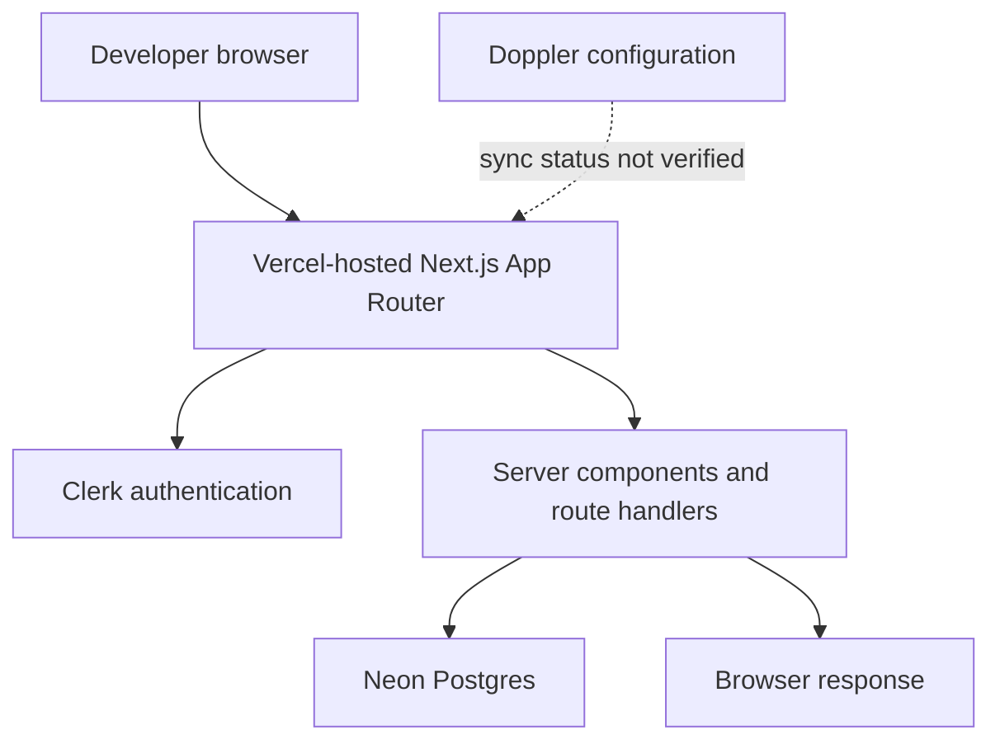

# Ori Developer Platform Architecture

**Status:** Current-state architecture with target boundaries  
**Last reviewed:** 2026-11-14

This document distinguishes what is implemented today from the architecture the product is intended to grow into. A proposed component must not be shown as a live capability until it exists and has been verified.

## 1. Current application shape

- **Repository:** `30lnewcomb-byte/ori-developer-platform`
- **Framework:** Next.js App Router with React and TypeScript.
- **Hosting:** Vercel project `ori-developer-platform`.
- **Authentication:** Clerk using `@clerk/nextjs`.
- **Database:** Neon Postgres using `@neondatabase/serverless`.
- **Secrets/configuration:** Vercel environment variables; Doppler-related variables are present, but the active sync mapping remains unverified.
- **Source branch:** `main`.

The Developer Platform is intentionally a separate application. It must not import private implementation details from Ori Platform or Ori Intelligence. Future communication with those systems should use versioned, authenticated APIs.

## 2. Current request flow

### Authentication boundary

- The root layout wraps the application with `ClerkProvider`.
- `proxy.ts` initializes Clerk request context for application routes; it does not make route-level authorization decisions.
- Protected page resources call `auth.protect()` inside the page. Unauthenticated document requests can then follow Clerk's configured sign-in redirect behavior.
- Route handlers authenticate independently. The Projects API uses `auth()` and returns a JSON 401 when no user is signed in.
- The home page is public and redirects an authenticated user to `/dashboard`.
- Every page, route handler, and server action that reads or mutates protected data must authorize that resource itself. Middleware initialization is not a substitute for resource-level checks.

### Projects API

Implemented route: `app/api/projects/route.ts`

- `GET /api/projects`: returns up to 100 projects owned by the authenticated Clerk user.
- `POST /api/projects`: validates the name and description, generates a slug, and creates the project for the authenticated user.
- Owner identity comes from Clerk server-side; the browser cannot choose the owner.
- Database connection uses `DATABASE_URL` with `POSTGRES_PRISMA_URL` as a fallback.
- SQL statements use Neon’s parameterized tagged-template interface.
- Known database failures are translated into safe API errors; connection strings are not returned to clients.

### Current project table

Migration: `db/migrations/001_create_projects.sql`

The migration creates `ori_dev_projects` with:
- UUID primary key.
- `owner_id` containing the Clerk user identifier.
- Name, slug, and optional description.
- Creation/update timestamps.
- Unique constraint on `(owner_id, slug)`.
- Index on `(owner_id, created_at DESC)`.

The migration is deliberately manual. Its presence in Git does not prove that it has been applied to Neon. Confirm the target Neon project and table before enabling Projects CRUD in production.

## 3. Current deployment and integration observations

This section records inspection results, not a billing guarantee.

| Component | Evidence observed | Current confidence |
|---|---|---|
| Vercel hosting | Production deployment reports READY; public landing page returned HTTP 200 | Confirmed |
| Neon | Database environment-variable names with integration-store metadata exist for Preview and Production | Variables confirmed; database query and schema state still need verification |
| Clerk | Publishable and secret key variable names exist for Preview and Production; live page served a `pk_test_*` key from a `*.clerk.accounts.dev` host | Development Clerk instance is being used by the inspected production deployment |
| Doppler | `DOPPLER_PROJECT`, `DOPPLER_ENVIRONMENT`, and `DOPPLER_CONFIG` names exist for Development, Preview, and Production | Variables confirmed; sync health and source-of-truth mapping not verified |
| Vercel Marketplace inventory | Integration configuration list endpoint returned 403 for the available connection | Full installed-integration and billing inventory unavailable through this inspection |

The Vercel project metadata also reported `live: false` while its latest production deployment reported READY. Treat this as a metadata discrepancy to reconcile, not as evidence that the deployment failed.

## 4. Environment separation

Maintain separate credentials and data boundaries for:
- **Development:** local development and safe test data.
- **Preview:** branch deployments and test data.
- **Production:** real users and production data.

Environment-variable changes apply to new deployments; existing deployments do not automatically receive changed values. After changing environment configuration, create and verify a new deployment.

Clerk production uses production keys and requires a domain owned by the application owner. The currently inspected production page uses a Clerk development key and development Frontend API domain. This is a release blocker for real production authentication, not a reason to copy development credentials into production.

Do not print or copy decrypted secrets into logs, documentation, Git history, or browser output.

## 5. Intended domain model

The current schema contains a per-user project registry only. The following are target concepts, not implemented tables:

- **Project:** application identity, owner, metadata, lifecycle.
- **Membership:** user/service identity, project, role, status.
- **Environment:** project-scoped Development, Preview/Staging, or Production configuration.
- **Credential:** key identifier, hash, scope, owner identity, created/rotated/revoked timestamps, last-used metadata. Never store recoverable API secrets.
- **Model configuration:** runtime/provider reference, model identifier, pinned version, enabled capabilities, routing policy.
- **Tool manifest:** tool ID/version, schemas, permissions, provider reference, availability.
- **Usage event:** request ID, project/environment, model/tool identity, result, latency and provider-reported usage values.
- **Audit event:** actor, action, target, timestamp, outcome, and redacted metadata.

Introduce each concept only with an owner, migration, authorization policy, and tests. Do not create speculative tables that the product does not yet use.

## 6. Security boundaries

- The authenticated identity is obtained on the server.
- Every project query is scoped by the authenticated owner or an explicitly authorized membership.
- Client-provided IDs are selectors, never proof of access.
- API credentials are not the same as Clerk session credentials.
- Secret material stays on the server and in the approved secret store.
- Provider errors must not leak environment variables, database URLs, or stack traces to the browser.
- Audit events record security-relevant actions without recording secret values.
- Test user A cannot read or mutate user B's project, even when B's project ID is supplied directly.

Before multi-user collaboration is implemented, add a membership model and central authorization helper. Do not scatter ad hoc role checks across page components.

## 7. Provider and runtime boundaries

The Developer Platform should communicate with Ori Intelligence, model services, and tool executors through explicit interfaces, for example:

- Model catalog and capability discovery.
- Inference request/response.
- Model health and readiness.
- Tool manifest and execution.
- Usage and request-event ingestion.

These interfaces are target architecture only. The current dashboard pages describe several of these resources as not connected; do not imply a live runtime connection until a real adapter and health check exist.

Keep provider-specific credentials and SDKs inside server-side adapters. The browser should call the Developer Platform's authenticated API, not receive provider secrets.

## 8. Deployment and change management

1. Develop in a feature branch.
2. Run format/type/build checks and targeted tests.
3. Review the diff and confirm no secret or unrelated repository changes.
4. Deploy a preview and inspect key pages and API behavior.
5. Merge the reviewed change to `main` through the repository's chosen review process.
6. Verify the production deployment, domain, authentication, and critical user journey.
7. Record any incomplete migration or provider setup as a visible release limitation.

Database migrations remain a separate deliberate operation. Do not automatically execute production DDL during a normal Vercel deployment.

## 9. Known gaps at this review

- Production Clerk instance/domain has not been configured.
- The Projects migration's application state has not been verified.
- Doppler sync configuration has not been verified.
- Vercel Marketplace integration inventory and billing plans could not be read through the available integration-inventory API permission.
- API key issuance, model catalog, runtime health, tools, audit events, and usage analytics are not yet connected.
- The repository has no test script or checked-in test suite at this baseline.
- The resource-level Clerk auth change is in the research branch and must pass the preview redirect/API checks before merge.

These gaps feed the priorities in `PRODUCT_ROADMAP.md`.
